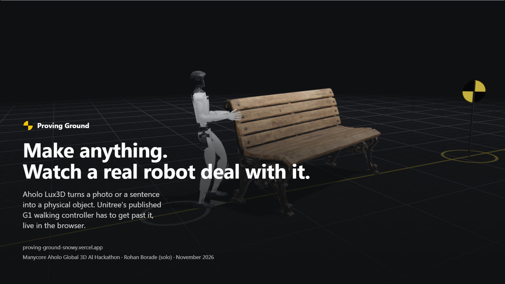

<p align="center"></p>

# Proving Ground

**Make anything with Aholo Lux3D, from a photo or a sentence, and watch a real robot controller deal with it.**

Lux3D builds the object at its real size and splits it into the parts it is made of. Each part becomes a solid with mass in a MuJoCo physics world running in your browser, in front of Unitree's G1 humanoid running Unitree's own published walking controller. Build a course from your own things, run it ten times, and see what the robot tripped on.

- **Try it:** https://proving-ground-snowy.vercel.app (no sign-up)
- **Arena:** https://proving-ground-snowy.vercel.app/arena
- **Report (PDF):** [docs/proving-ground-report.pdf](docs/proving-ground-report.pdf)
- **How it works, with every number we measured:** https://proving-ground-snowy.vercel.app/how

Built for the Manycore Aholo Global 3D AI Hackathon (November 2026).

## What you can do

| | |
|---|---|
| **Make** | Type a sentence, upload a photo, or scan the arena's QR code and snap something with your phone. Lux3D builds it in about 80 seconds. |
| **Watch it materialize** | Points condense into the shape, the texture sweeps in, part-split pulls it into pieces, each piece is wrapped in the convex hull the physics will feel, and it drops in front of the robot. |
| **Walk** | Blind walk (the controller only feels its joints), planner (an A* path around the object footprints) or steer it yourself. |
| **Test** | Ten seeded trials: the robot starts a little off-line, objects shift, optional shoves. Pass rate, falls, and what it tripped on. |
| **Share** | Save a course, send the link, climb the gauntlet: courses ranked by how often the robot fails them. |
| **Take it home** | Every object downloads as a robot-ready pack: textured GLB, one STL hull per part, and an MJCF body with masses. |

## How Lux3D is used

Every object in the world comes out of Aholo's API:

| Step | Aholo call | Credits (live quote) |
|---|---|---|
| Upload a photo or an intermediate GLB | Asset upload (OUS) | 0 |
| Photo to 3D | `lux3d/v1/generate/img-to-3d` (G1-Turbo) | 1 |
| Sentence to 3D | `lux3d/v1/generate/text-to-3d` (G1-Turbo) | 13 |
| Separate the parts | `lux3d/v1/part-split` | 30 |
| Rig a person | `lux3d/v1/animations/rig` | 15 |
| Make them walk | `lux3d/v1/animations/retarget` (Walk_Loop) | 6 |
| Price a job first | `lux3d/v1/pricing/openapi-quotes` | 0 |

Things we learned the hard way are in [web/src/lib/pipeline/README.md](web/src/lib/pipeline/README.md): inputs must go through Aholo's own upload (third-party URLs fail silently), outputs expire after two hours, and an account runs one generation at a time, so a single queue serves everyone.

## The robot

Unitree's G1 with its 12-joint leg model and Unitree's published walking policy from `unitree_rl_gym` (BSD-3-Clause). The LSTM is read straight from the TorchScript file and runs in plain JavaScript at 50 Hz on 500 Hz MuJoCo physics compiled to WebAssembly. After 2 s of walking it is within 2.5 µm of Unitree's Python reference; a 6 s walk covers 2.6983 m in both. It runs 12× faster than real time with one object, 3–4× with twenty. Details and limits: [web/src/sim/README.md](web/src/sim/README.md).

## Run it locally

```bash
cd web
npm install
cp .env.example .env.local   # add your Aholo API key to make new objects
npm run dev                   # http://localhost:3000
npm run test:sim              # physics and controller tests (Node 22+)
npm run test:pipeline         # pipeline tests (Lux3D mocked)
```

Without an Aholo key the arena still works with whatever is in your local library folder.

## Layout

- `web/src/sim`: physics worker, robot controller, navigation, trials, robot-ready export
- `web/src/lib/pipeline`: Aholo client, job queue, GLB processing, storage
- `web/src/three`: the renderer, the materializer, the arena view
- `web/src/app`: pages and API routes

## Credits

- 3D generation, part-split, rigging and animation: **Aholo Lux3D** by Manycore Tech.
- Robot model and walking policy: **Unitree Robotics**, BSD-3-Clause.
- Physics: **MuJoCo** by Google DeepMind, Apache-2.0.
- Rendering: three.js, MIT.

Code in this repository: Apache-2.0. By Rohan Borade.
